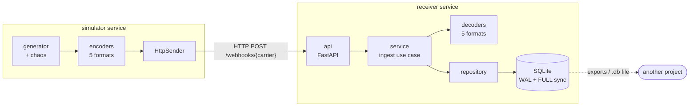

# Architecture

## The big picture



One Docker image runs both services; `docker-compose.yml` decides which one by its `command`.

## Layers and the one rule

```
domain  <--  formats  <--  simulator
   ^            ^
   +------------+------  receiver
```

**Inner layers never import outer ones.**

| Layer | Knows about | Must NOT know about |
| --- | --- | --- |
| `domain` | carriers, statuses, events, randomness | HTTP, SQL, env vars, formats |
| `formats` | how a carrier encodes/decodes an event | HTTP, SQL, settings |
| `simulator` | settings, pacing, HTTP client | SQL |
| `receiver/api` | HTTP routes, status codes | SQL |
| `receiver/service` | the ingestion steps | HTTP, SQL text |
| `receiver/repository` + `db` | SQL, transactions, schema | HTTP |

Practical payoff: `domain/` and `formats/` are plain Python that you can copy into another
project, and swapping SQLite for PostgreSQL later only touches `repository.py` and `db.py`.

## ACID, one letter at a time

The receiver stores events in SQLite: fully ACID, no extra container, and the whole database is
**one file** that is easy to hand to another project.

| Property | How it is guaranteed (see `receiver/db.py`) | Where it is tested |
| --- | --- | --- |
| **Atomicity** | Every write runs inside an explicit transaction (`BEGIN IMMEDIATE` … `COMMIT`, `ROLLBACK` on any exception). Schema migrations are transactional too. | `test_atomicity_…` |
| **Consistency** | `STRICT` tables, `NOT NULL`, `CHECK (delivery_count >= 1)` and `UNIQUE (carrier, event_id)`: the database itself rejects bad rows, not only our code. | `test_consistency_…` |
| **Isolation** | WAL mode (readers never block the writer and always see committed data) + `BEGIN IMMEDIATE` (concurrent writers queue instead of deadlocking) + a 10 s busy timeout. | `test_isolation_…`, `test_concurrent_…` |
| **Durability** | `synchronous = FULL`: once we answer `200`, the event survives a crash or power cut. | `test_durability_…` |

### Idempotency (why duplicates are harmless)

An event is identified by `(carrier, event_id)`. Saving uses a single atomic statement:

```sql
INSERT … ON CONFLICT (carrier, event_id)
DO UPDATE SET delivery_count = delivery_count + 1, last_received_at = excluded.last_received_at
RETURNING delivery_count
```

* First time → new row, `delivery_count = 1`, answered `stored`.
* Repeat → no new row, counter bumped, answered `duplicate` (still `200`, so carriers stop retrying).
* Twelve identical requests racing each other still produce exactly one row.

### Nothing the carriers send is lost

* Unreadable payload → `422` **and** the raw body is parked in `rejected_events` with the reason.
* Unknown status → stored anyway, `canonical_status = NULL`, a warning is logged.
* Every stored event keeps its `raw_body` untouched next to the parsed columns.

## Data model

`events` — one row per distinct event; `id` is also the **arrival order**, which is what makes
out-of-order detection and incremental exports possible.

| Column | Meaning |
| --- | --- |
| `id` | Auto-increment, in arrival order. It may skip numbers (a repeated event burns one), so treat it as a cursor (`after_id`), not as a row count. |
| `carrier`, `event_id` | Identity of the event (unique together). |
| `tracking_number` | Shipment the event belongs to. |
| `raw_status` | Exactly what the carrier sent. |
| `canonical_status` | Our translation (`CREATED`, `IN_TRANSIT`, …) or `NULL` if unmapped. |
| `occurred_at` | When it happened, ISO-8601 UTC (`2026-10-13T12:30:15.000Z`). |
| `location` | City/hub. |
| `content_type`, `raw_body` | The original request. |
| `delivery_count` | How many times it arrived (1 = no duplicates). |
| `first_received_at`, `last_received_at` | Arrival timestamps (UTC). |

`rejected_events` — `id, carrier, content_type, raw_body, reason, received_at`.

The schema is versioned with `PRAGMA user_version`; to change it, **append** a migration to
`MIGRATIONS` in `db.py` (never edit an old one). It runs automatically on startup.

## Other decisions worth knowing

* **Pacing uses a fixed schedule** (not "sleep after each send"), so the real rate matches
  `SIM_RATE` even when requests take a while. A stop request wakes the loop immediately.
* **Sequential sending on purpose.** Out-of-order events are injected deliberately; real
  concurrency would add accidental disorder and make runs less reproducible.
* **Reproducibility:** the same `SIM_SEED` gives the same events, ids, duplicates and ordering
  (timestamps depend on the clock unless it is injected, as the tests do).
* **XML is parsed with `defusedxml`**, so entity-expansion bombs can't hurt the receiver.
* **Strict timestamps:** a time without a timezone is rejected instead of guessed.
* **Non-root container**, health-checked receiver, simulator waits for it to be healthy.
